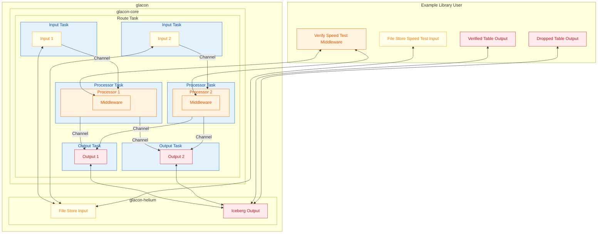
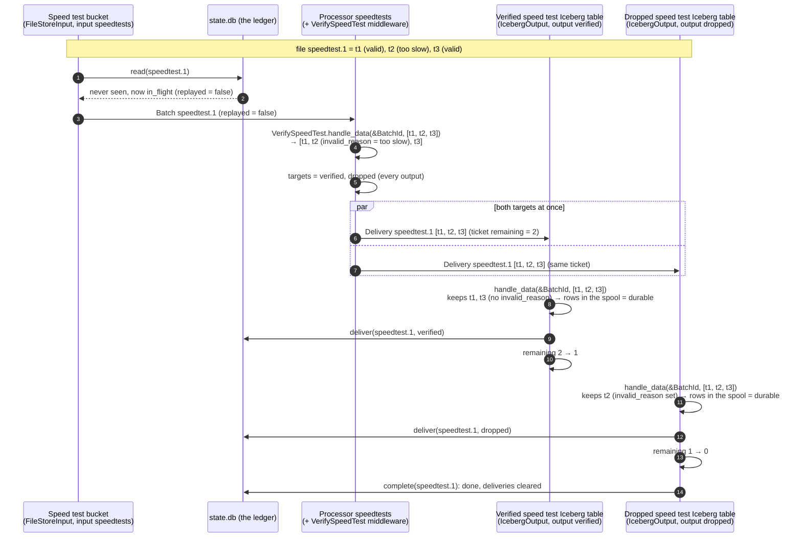
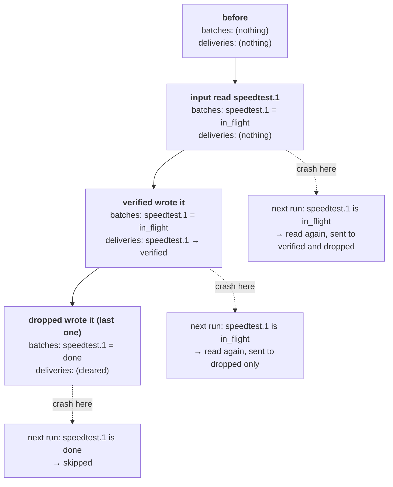
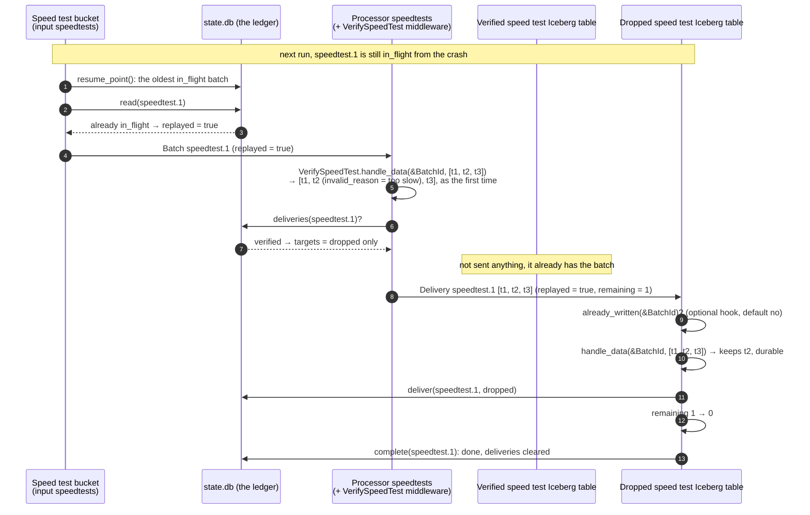

# glacon

Route records from inputs, through a middleware, to outputs: protobuf files
from S3 buckets into Iceberg tables, for example.

A **route** reads records from **N inputs**, runs every batch through a
**middleware** that transforms them, and hands them to its **M outputs**, each
keeping the records it wants. A route is an oracles `task_manager::ManagedTask`: run it in your
app's `TaskManager`, next to your other routes and tasks.

## Architecture



Blue boxes are tasks, yellow are inputs, orange are processors and their
middleware, red are outputs.

- Every input runs in its own task and feeds its own processor through a
  channel.
- Every processor runs its own instance of the route's middleware, and sends
  every output the batch it transformed, through one channel per output.
- Every output runs in its own task, fed by every processor.
- Channels hold one batch besides the one being handled: a slow stage makes
  the stages before it wait.

## Crates

| Crate | Does |
|---|---|
| `glacon-core` | The route, its tasks and its delivery ledger (SQLite). Knows nothing of S3 or Iceberg: inputs, middlewares and outputs are traits. Depends on oracles' `task-manager` and `sqlx`. |
| `glacon-helium` | `FileStoreInput` (polls a bucket with oracles' `file_store`) and `IcebergOutput` (writes a table with `helium_iceberg`). Re-exports everything from `glacon-core`, so apps depend on it alone. |
| `glacon-test-proto` | Protobuf messages for the tests. |

## Hooks

Every stage follows the same lifecycle, all async: `init`, its main hook,
then `terminate`.

| Stage | `init` | main hook | `terminate` |
|---|---|---|---|
| input | `GlaconCoreInput::init(&mut self, ctx)`: connect, build a poller, …; resume from `ctx.ledger()`; returns its `State` and an optional background task (`InitializedInput`) | `GlaconCoreInput::next_batch(&mut state)`: the next `Batch`, or `None` when done | — (the input and its state are dropped) |
| middleware | `GlaconCoreMiddleware::init(&mut self, ctx)`: open a connection, … | `handle_data(&BatchId, Vec<In>) -> Vec<Out>`: transform the records, leaving out the ones to drop | release |
| output | `GlaconCoreOutput::init(&mut self, ctx)`: connect, create the table, …; returns its `State`, an optional background task, and whether the destination already holds data (`InitializedOutput::with_existing_data`) | `GlaconCoreOutput::handle_data(&mut state, &BatchId, &[R])`: gets every record of the batch, writes the ones it keeps, `Ok` once durable. Optional: `already_written(&mut state, &BatchId)`, asked on replays | `GlaconCoreOutput::terminate(&mut state)`: flush |

Inputs and outputs are **one trait each**, implemented by their
configuration (what you give the builder). `init` builds the stage's
`State` (a plain struct: connections, channels, writers), and every later
call gets both the configuration (`&mut self`) and that state, so the state
holds only what exists once started: no `Option` fields, no "not
initialized" case. `FileStoreInput` keeps its files receiver in a
`FileStoreState`, `IcebergOutput` its writer in an `IcebergState`. A stage
with nothing to set up has `type State = ()` and returns
`Ok(InitializedInput::new(()))`.

The middleware's `init` and `terminate` default to doing nothing, as does
the output's `terminate`. The `*Context` handed to `init` names the
route and the stage, and an input's gives it its view of the ledger. Any
`Send + Sync + 'static` type is a record (`GlaconRecord`).

`BatchId { input, key, timestamp }` names the batch records came from: the
input's name, and the `Batch`'s key and timestamp. The key must be the same
every time the input produces that batch (an S3 key, for example).

### Background tasks

An input's or output's `init` adds a task, an oracles `ManagedTask`, when it
needs work running beside it: a poller feeding the input's state, a writer
committing the output's rows (`InitializedInput::new(state).with_task(poller)`).
Several tasks can be bundled into one `TaskManager`. The route supervises it:

- it is started before its stage and stopped after it: an input's task stops
  once the input stopped reading, an output's once the output terminated;
- its failure fails the route with the stage's error (`Error::Input` /
  `Error::Output`), and a panic with `Error::Panic` naming it (e.g.
  `input us: background`).

`init` must not spawn anything itself: if another stage then fails to
initialize, the route drops the returned tasks without ever starting them.
Without a task, there is nothing to supervise.


### Up and down

**Up:** before any task starts, the route opens its ledger, then initializes
its stages layer by layer: every output (then the fresh-state guard, see
below), then every input's middleware, then every input. If an `init` fails,
the layers already initialized are terminated and the route fails.

**Down:** the stages stop in reverse: inputs, then their background tasks,
then processors (handling what is queued, then the middleware's
`terminate`), then outputs (writing what is queued, then `terminate`), then
their background tasks. A stage always stops after everything feeding it:

- on shutdown: the route's TaskManager stops its tasks in that order;
- when every input is done: inputs return, their processors drain and stop,
  then the outputs drain and stop, and the route ends;
- on failure: the failing stage stops, the stages upstream of it stop first,
  then the rest of the route goes down in order, and the route fails with the
  stage's error (`Error::Input`, `Middleware`, `Output` or `Panic`).

## Delivery guarantees

If anything goes wrong (a crash, a failing output, a kill), a route run again
on the same `state_dir` gets back on its feet **without losing data**, and
duplicates nothing outside one small window.

### `state.db` (the ledger)

Every route keeps a SQLite database, `<state_dir>/state.db`
(`RouteSettings::state_dir`, which **must be durable**: a mounted volume). It
stores **no records**, only:

| Table | Holds |
|---|---|
| `batches` | One row per batch read: input, key, timestamp, `in_flight` or `done` |
| `deliveries` | Which outputs already took each `in_flight` batch (cleared once it is done) |

Records live in memory between stages. Recovery relies on the two places that
already hold them durably: the **source**, where a batch stays readable until
it is done, and the **outputs**, which have a batch durably once they
acknowledged it. So **inputs must be replayable**: after a restart, an input
produces again every batch not done, resuming from
`ctx.ledger().resume_point()` and skipping what `is_done(key)` says (the route
skips done batches itself too). S3 qualifies.

### One batch, from read to done

1. **Input task**: after `next_batch`, the route records the batch in the
   ledger. A batch never seen is now `in_flight`, one already `in_flight` is a
   **replay**, one `done` is skipped.
2. **Processor**: the middleware transforms the records. Every output (a
   **target**) gets the whole batch, except, on a replay, the outputs that
   already took it. A batch the middleware emptied, or with no target left,
   is done right away. Otherwise the targets share one ticket that counts
   them.
3. **Output task**: on a replay, `already_written` is asked first (optional,
   default no). Then `handle_data`, which writes the records this output
   keeps (maybe none): returning `Ok` means durable, and **is** the
   acknowledgement. The output is recorded in `deliveries`, then counts
   down the ticket. The last one marks the batch `done` (deliveries cleared,
   in one transaction).

A failing output never acknowledges: its batches stay `in_flight` and are
replayed on the next run, to that output only.



### Crash at each point



| Crash after… | `state.db` | Next run |
|---|---|---|
| reading a batch, before recording it | nothing | read again |
| recording it, before any write | `in_flight` | replayed to every target |
| an output's durable write, before it is recorded | `in_flight`, that output missing | **that output gets it again**, unless it implements `already_written` (the duplicate window) |
| one output recorded, not the others | `in_flight`, that output recorded | replayed to the others only |
| the last output recorded | `done` | skipped |
| a shutdown while a batch waited to be sent | `in_flight` | replayed |

The duplicate window is one batch, for one output, per crash: the process
died between the output's write and the ledger recording it. An output that
can tell it already has a batch (an idempotent key, a transactional sink)
closes it with `already_written`.

### The run after a crash



### Resume point and retention

Outputs finish at different speeds, so a later batch can be done before an
earlier one. An input resumes at its **oldest `in_flight` batch**, else its
newest done one. Done batches are forgotten after
`RouteSettings::processed_retention` (default 3 days), keeping each input's
newest done batch and every `in_flight` one. The retention must cover how far
back an input may produce a batch again (a file store poller's `offset`): a
forgotten batch seen again is delivered again.

### Replay-safe middleware and outputs

On a replay, the middleware sees the batch again, and must give the same
records. A stateless middleware does. One with state, like a deduplicating
one, keys it by `&BatchId`: remember which batch claimed each record, and
keep a record its own batch claimed (see `deduplication_is_a_middleware` in
`glacon-core/tests/integration/routing.rs`). Likewise, an output decides what
to keep from the record alone.

### Lost state: the fresh-state guard

If `state.db` is lost (a volume not mounted, say), every input would start
over and duplicate what the outputs hold. So when a route starts with a
`state.db` it never ran on, and an output's `init` reported existing data
(`InitializedOutput::with_existing_data(true)`), the route refuses to start
(`Error::FreshStateRefused`), terminating the outputs it initialized. To start
over on purpose, build it with `.fresh_state(FreshState::Proceed)`.
`IcebergOutput` reports existing data when its table already has a snapshot.

### Durability

"Durable" means it survives a process crash. `IcebergOutput` acknowledges a
batch once its rows are in the writer's spool, which the writer commits on
its next start. Two caveats, from `helium_iceberg`:

- the spool is only fsynced at commit, so a machine or power loss can drop
  rows the ledger counts as delivered;
- a crash after a commit but before its spool file is removed commits that
  file again on the next start, duplicating up to `max_batch_rows` rows.

`glacon-helium/tests/integration/crash.rs` kills a route with SIGKILL
mid-run and checks that a restart loses nothing.

[docs/runtime.md](docs/runtime.md) shows how a route is split into Tokio
tasks, where your code runs, and every step a record goes through from
startup to shutdown.

## Usage

The middleware decides once whether a speed test is valid and sets the
result on the record. Each table keeps what it wants: valid tests in one,
invalid ones in the other. Malformed tests reach neither.

```rust
use glacon_helium::{
    BatchId, BoxError, FileStoreInput, GlaconCoreMiddleware, GlaconOutput, IcebergOutput,
    Route, RouteSettings, async_trait, task_manager::TaskManager,
};

/// What the outputs get: a speed test and the verdict on it.
#[derive(Clone)]
struct VerifiedSpeedTest {
    test: SpeedTest,
    invalid_reason: Option<InvalidReason>,
}

// Cloned for each input's processor.
#[derive(Clone)]
struct VerifySpeedTest;

#[async_trait]
impl GlaconCoreMiddleware<SpeedTest, VerifiedSpeedTest> for VerifySpeedTest {
    async fn handle_data(
        &mut self,
        _: &BatchId,
        tests: Vec<SpeedTest>,
    ) -> Result<Vec<VerifiedSpeedTest>, BoxError> {
        Ok(tests
            .into_iter()
            .filter(|t| !t.is_malformed()) // dropped: no output gets it
            .map(|test| VerifiedSpeedTest { invalid_reason: test.verify(), test })
            .collect())
    }
}

impl GlaconOutput<VerifiedSpeedTest> for VerifiedTable {
    // table() ...
    fn to_rows(&self, t: &VerifiedSpeedTest, rows: &mut Vec<VerifiedRow>) {
        if t.invalid_reason.is_none() {
            rows.push(VerifiedRow::from(&t.test));
        }
    }
}
// DroppedTable keeps the tests whose invalid_reason is set, with the reason.

// The ledger goes in /data/speedtests/state.db: a durable volume.
let route = Route::builder("speedtests", RouteSettings::new("/data/speedtests"))
    .input("us", FileStoreInput::new(SpeedTestInput, us_settings))   // SpeedTest
    .input("eu", FileStoreInput::new(SpeedTestInput, eu_settings))
    .middleware(VerifySpeedTest)                                      // -> VerifiedSpeedTest
    .output("verified", IcebergOutput::new(VerifiedTable, verified_settings))
    .output("dropped", IcebergOutput::new(DroppedTable, dropped_settings))
    .build()?;

TaskManager::builder().add_task(route).build().start().await?;
```

- The builder follows the data: inputs, then the middleware, then outputs.
  The middleware sets the type outputs get, so the compiler enforces the
  order.
- A route has one middleware, given as a value implementing
  `GlaconCoreMiddleware` and cloned for each input's processor. Share state
  between the clones through an `Arc`; create what can't be cloned (a
  connection) in its `init`. Without one, outputs get the inputs' records
  unchanged (`Passthrough`).
- **Drop or annotate.** A record no output should get (malformed, a
  duplicate) is dropped by the middleware, leaving it out. A decision outputs
  depend on (valid or not) is set on the record, and each output filters on
  it.
- Give every route its own `state_dir`. `RouteSettings` is serde-ready
  (`state_dir`, `processed_retention`).
- `Route` names its tasks `input <name>`, `processor <name>` and
  `output <name>` in the TaskManager's logs.

## glacon-helium

| You implement | Wrapped by | Does |
|---|---|---|
| `GlaconInput` | `FileStoreInput::new(input, InputSettings)` | One kind of file: file prefix + protobuf message → record. Returning `None` drops the message (logged at error, counted). |
| `GlaconOutput` | `IcebergOutput::new(output, OutputSettings)` | One table: its definition + record → 0..n rows. It gets every record: no rows drops one. |

`InputSettings` and `OutputSettings` are serde-ready so apps can embed them in
their own configuration.

**`FileStoreInput`** polls one bucket. Its `init` builds the `file_store`
poller (named after the input) and returns it as its background task;
`next_batch` decodes the next file into a batch. When the poller stops on its
own (its `idle_timeout`), the input is done; if it fails, the route does.

Each file is one batch, keyed by its S3 key. The poller's state is the
route's ledger: it resumes at the oldest file not delivered everywhere (minus
its `offset`, to catch late uploads), and skips the files that were. Files
stay in their bucket, so a file is read again after a crash until it is done.

**`IcebergOutput`** writes one table. Its `init` creates the namespace and
table if missing and returns the `helium_iceberg::BatchedWriter`'s task as
its background task, spooling to `<spool_dir>/<route>/<output>`;
`handle_data` returns once the rows are in the spool. They are committed
every `max_batch_rows` rows or `batch_timeout`, and when the route stops the
writer. Its `init` reports existing data when the table already has a
snapshot (see the fresh-state guard).

- Output tables must be partitioned: `helium_iceberg` cannot write to an
  unpartitioned table.
- Missing tables are created from `GlaconOutput::table()`. Schema changes are
  not handled.

## Metrics

Emitted through the `metrics` facade (the app installs an exporter). Every
series has a `route` label, plus `input` or `output` where it applies:

- `glacon_processed_batches_total`
- `glacon_batch_lag_seconds`
- `glacon_batch_processing_seconds`
- `glacon_middleware_dropped_total`: records the middleware left out
- `glacon_output_records_total`: records handed to an output (it may keep
  fewer: see `glacon_output_rows_total`)
- `glacon_replayed_batches_total`: batches read again after a run that did
  not finish them
- `glacon_skipped_deliveries_total`: deliveries skipped because the output
  already had the batch (from the ledger, or `already_written`)
- `glacon_in_flight_batches`: batches of an input read but not done (updated
  hourly)
- `glacon_state_pruned_total`: done batches forgotten by retention
- `glacon_records_decoded_total` (`FileStoreInput`)
- `glacon_decode_failures_total` (`FileStoreInput`)
- `glacon_output_rows_total` (`IcebergOutput`)

## Development

`glacon-core`'s tests run on their own, against in-memory inputs, middlewares
and outputs, each route with a real `state.db` in a temp dir:

```bash
cargo nextest run -p glacon-core
```

`glacon-helium`'s integration tests need RustFS, Polaris and Trino
(`docker-compose.yml`; every config is inlined there) and `protoc` for the
test messages:

```bash
docker compose up -d --wait
cargo nextest run --workspace
```

Use `cargo nextest run`, not `cargo test`: under `cargo test`, every test gets
its own Tokio runtime inside one process, and `file_store`'s cached S3 clients
then fail across runtimes. `.config/nextest.toml` also caps how many of
glacon-helium's integration tests run at once against the shared Polaris.

The test environment (`glacon-helium/tests/integration/common/harness.rs`)
gives each test its own Iceberg catalog, buckets, spool and state
directories.
