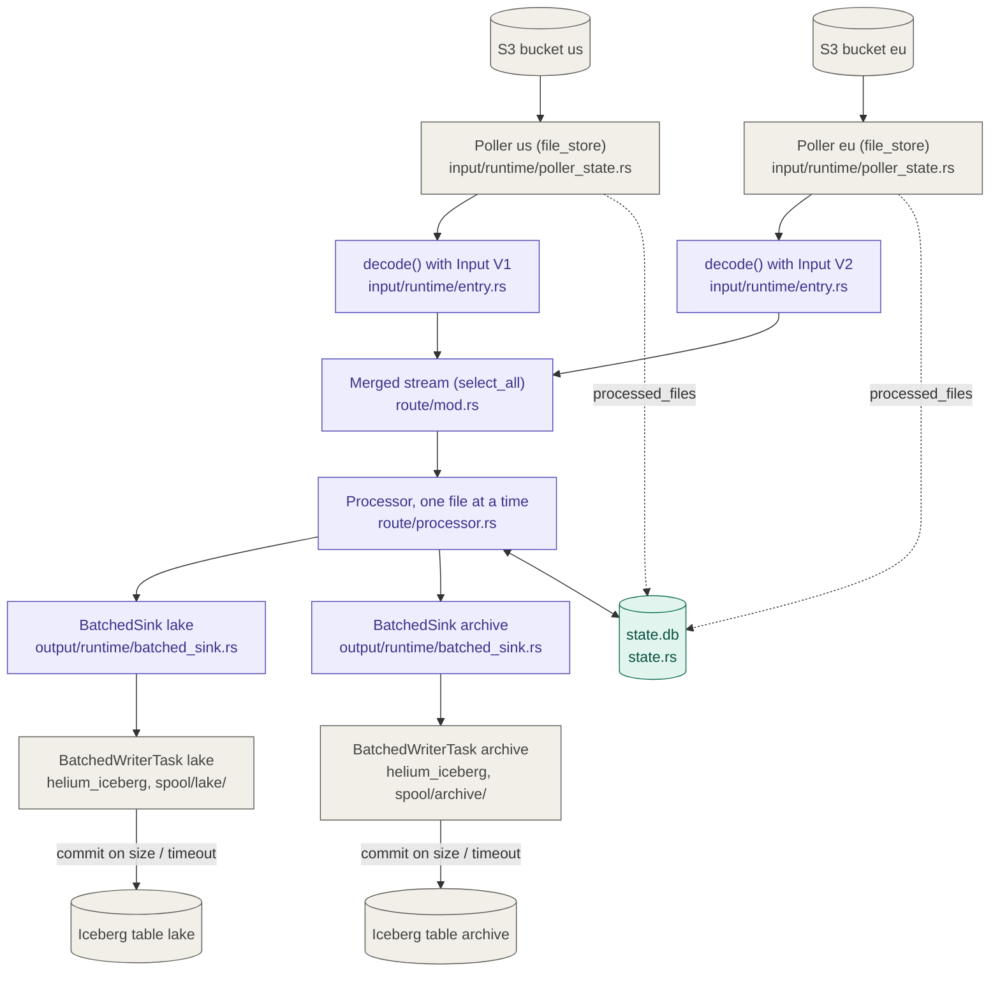
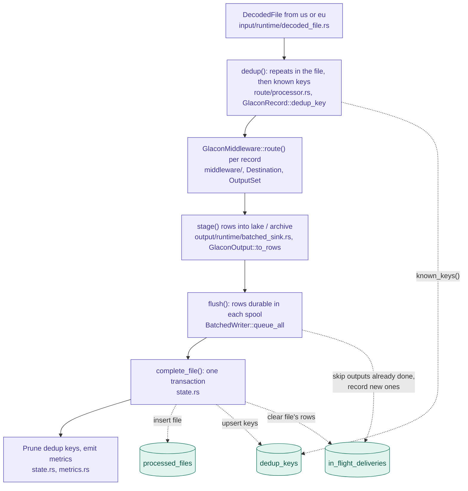

# glacon

A library to route protobuf files from S3 buckets into Iceberg tables.

A **route** reads one record type from **N inputs** (buckets), lets one
**middleware** pick which of its **M outputs** (tables) get each record, and
keeps its progress in its own SQLite database. `Glacon` runs every route as a
task on oracles' `task_manager`.

```text
input "us" ─┐                          ┌─► output "lake"    (rows A)
            ├─► record ─► middleware ──┤
input "eu" ─┘                          └─► output "archive" (rows B)
```

Built on [helium/oracles](https://github.com/helium/oracles): `file_store`
polls the buckets, `helium_iceberg` writes the tables.

## What you implement

| Trait | Does |
|---|---|
| `GlaconRecord` | The route's record type. Optional `dedup_key()`; `None` means never deduplicated. |
| `GlaconInput` | One kind of file: file prefix + protobuf message → record. Returning `None` drops the message (logged at error, counted). |
| `GlaconMiddleware` | Record → `Destination::All` (default), `Only(outputs)` or `Drop`. Created by `middleware_with`, which looks its outputs up by name (an unknown name fails `build()`). |
| `GlaconOutput` | One table: its definition + record → 0..n rows. |

```rust
let route = Route::builder("events", RouteSettings::new("/var/lib/glacon/events"))
    .input("us", EventV1Input, us_input_settings)
    .input("eu", EventV2Input, eu_input_settings)
    .output("lake", EventsTable, lake_settings)
    .output("values", ValuesTable, values_settings)
    // Created during build(), with the ids of the outputs it selects.
    .middleware_with(|outputs| {
        Ok(MyMiddleware {
            lake: outputs.id("lake")?,
            values: outputs.id("values")?,
        })
    })
    .build()?;

Glacon::new().route(route).run().await?;
```

`RouteSettings`, `InputSettings` and `OutputSettings` are serde-ready so apps
can embed them in their own configuration.

## How a route runs

Each route is one task with its own task manager: N pollers feed one
processor, which feeds M writers. Here with inputs `us`/`eu` and outputs
`lake`/`archive`, labelled with the files that implement each part:



Purple is glacon code, gray is oracles crates and storage, green is the
route's state.

What the processor does with one file, and which `state.db` table each step
touches:



A file lands in `processed_files` only after every output has its rows durably
in the spool. A crash before that means the file is read again, and
`in_flight_deliveries` keeps an output that already took it from getting its
rows twice.

- Each input file is read once. The processor handles one file at a time, in
  this order: decode, dedup, middleware, then each output's rows are spooled.
  A slow output stalls its route.
- Every output has a `helium_iceberg::BatchedWriter`: rows are spooled to disk,
  then committed in batches (`max_batch_rows` / `batch_timeout`).
- If any route fails, the whole process stops.

[docs/runtime.md](docs/runtime.md) shows how a route is split into Tokio
tasks, where your trait implementations run, and every step a record goes
through from setup to shutdown.

## State

`<state_dir>/state.db` (SQLite) is the route's only source of truth; nothing
is read back from the tables. It holds:

- `processed_files`: what each input has fully processed. It backs
  `file_store`'s poller state (resume point and skipping re-listed files) and
  is kept for `files_retention` (default 3 days).
- `in_flight_deliveries`: outputs that already took a file still in progress, so a
  re-read after a crash skips them.
- `dedup_keys`: dedup key hashes shared by all inputs, kept for
  `dedup_retention` (default 3 days).

`state_dir` must be durable. If a route starts with an empty state but an
output table already has data (a lost volume, for example), it refuses to start
unless built with `.fresh_state(FreshState::Proceed)`. Proceeding re-ingests
from each input's `start_after`.

Guarantee: at-least-once with a small duplicate window, narrowed by dedup.

## Constraints

- Output tables must be partitioned: `helium_iceberg` cannot write to an
  unpartitioned table.
- Missing tables are created from `GlaconOutput::table()`. Schema changes are not
  handled.
- At most 64 outputs per route.

## Metrics

Emitted through the `metrics` facade (the app installs an exporter). Every
series has a `route` label, plus `input` or `output` where it applies:

- `glacon_processed_files_total`
- `glacon_file_lag_seconds`
- `glacon_file_processing_seconds`
- `glacon_records_decoded_total`
- `glacon_decode_failures_total`
- `glacon_dedup_dropped_total`
- `glacon_middleware_dropped_total`
- `glacon_output_records_total`
- `glacon_output_rows_total`
- `glacon_state_pruned_total` (`kind` is `processed_files` or `dedup_keys`)

## Development

The integration tests need RustFS, Polaris and Trino (`docker-compose.yml`;
every config is inlined there) and `protoc` for the test messages:

```bash
docker compose up -d --wait
cargo nextest run
```

Use `cargo nextest run`, not `cargo test`: under `cargo test`, every test gets
its own Tokio runtime inside one process, and `file_store`'s cached S3 clients
then fail across runtimes. `.config/nextest.toml` also caps how many
integration tests run at once against the shared Polaris.

The test environment (`tests/integration/common/harness.rs`) gives each test
its own Iceberg catalog, buckets and state dirs.
