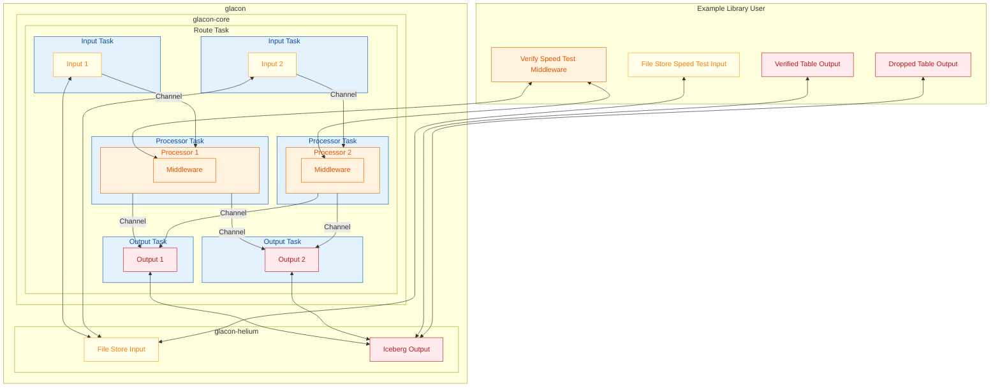

# glacon

Route records from inputs, through a middleware, to outputs: protobuf files
from S3 buckets into Iceberg tables, for example.

A **route** reads one record type from **N inputs**, runs every batch through
a **middleware** that picks which of its **M outputs** get each record, and
writes them. A route is an oracles `task_manager::ManagedTask`: run it in your
app's `TaskManager`, next to your other routes and tasks.

## Architecture



Blue boxes are tasks, yellow are inputs, orange are processors and their
middleware, red are outputs.

- Every input runs in its own task and feeds its own processor through a
  channel.
- Every processor runs its own instance of the route's middleware, and sends
  each output the records routed to it, through one channel per output.
- Every output runs in its own task, fed by every processor.
- Channels hold one batch besides the one being handled: a slow stage makes
  the stages before it wait.

## Crates

| Crate | Does |
|---|---|
| `glacon-core` | The route and its tasks. Knows nothing of S3 or Iceberg: inputs, middlewares and outputs are traits. Depends on oracles' `task-manager` only. |
| `glacon-helium` | `FileStoreInput` (polls a bucket with oracles' `file_store`) and `IcebergOutput` (writes a table with `helium_iceberg`). Re-exports everything from `glacon-core`, so apps depend on it alone. |
| `glacon-test-proto` | Protobuf messages for the tests. |

## Hooks

Every stage has the same lifecycle, all async:

| Trait (core) | `init` | main hook | `terminate` |
|---|---|---|---|
| `GlaconCoreInput` | prepare to read (e.g. start a poller) | `next_batch()`: the next `Batch`, or `None` when done | release what `init` set up |
| `GlaconCoreMiddleware` | prepare (e.g. open a connection) | `handle_data(&[R])`: one `Destination` per record (`All`, `Only(outputs)` or `Drop`) | release |
| `GlaconCoreOutput` | prepare to write (e.g. create the table) | `handle_data(&[&R])`: write the records routed here | flush, then release |

`init` and `terminate` default to doing nothing. A stage keeps its own state
in `self`; the `*Context` handed to `init` names the route and the stage. Any
`Send + Sync + 'static` type is a record (`GlaconRecord`).

Core has no state and no deduplication: a middleware that drops what it
already saw is user code (see `deduplication_is_a_middleware` in
`glacon-core/tests/integration/routing.rs`).

### Up and down

**Up:** before any task starts, the route initializes its stages layer by
layer: every output, then every input's middleware, then every input. If an
`init` fails, the layers already initialized are terminated and the route
fails.

**Down:** the stages stop in reverse: inputs, then processors (handling what
is queued), then outputs (writing what is queued). Each runs its stage's
`terminate` as it stops. A stage always terminates after everything feeding
it:

- on shutdown: the route's TaskManager stops its tasks in that order;
- when every input is done: inputs return, their processors drain and stop,
  then the outputs drain and stop, and the route ends;
- on failure: the failing stage stops, the stages upstream of it stop first,
  then the rest of the route goes down in order, and the route fails with the
  stage's error (`Error::Input`, `Middleware`, `Output` or `Panic`).

[docs/runtime.md](docs/runtime.md) shows how a route is split into Tokio
tasks, where your code runs, and every step a record goes through from
startup to shutdown.

## Usage

```rust
use glacon_helium::{
    BoxError, Destination, FileStoreInput, GlaconCoreMiddleware, IcebergOutput, OutputId, Route,
    async_trait, task_manager::TaskManager,
};

// One instance per input's processor.
struct VerifySpeedTest {
    verified: OutputId,
    dropped: OutputId,
}

#[async_trait]
impl GlaconCoreMiddleware<SpeedTest> for VerifySpeedTest {
    async fn handle_data(&mut self, tests: &[SpeedTest]) -> Result<Vec<Destination>, BoxError> {
        Ok(tests
            .iter()
            .map(|t| if t.is_valid() { self.verified.into() } else { self.dropped.into() })
            .map(Destination::Only)
            .collect())
    }
}

let route = Route::builder("speedtests")
    .input("us", FileStoreInput::new(SpeedTestInput, us_settings, pool.clone()))
    .input("eu", FileStoreInput::new(SpeedTestInput, eu_settings, pool.clone()))
    .output("verified", IcebergOutput::new(VerifiedTable, verified_settings))
    .output("dropped", IcebergOutput::new(DroppedTable, dropped_settings))
    // Output names become ids: a typo fails build().
    .middleware_with(|outputs| {
        Ok(VerifySpeedTest {
            verified: outputs.id("verified")?,
            dropped: outputs.id("dropped")?,
        })
    })
    .build()?;

TaskManager::builder().add_task(route).build().start().await?;
```

- A route has one middleware. `middleware_with` builds it from the outputs'
  ids: it runs once in `build()` to check the names, then once per input
  when the route starts. `middleware(m)` clones `m` for each input instead.
  Without either, every record goes to every output (`AllOutputs`).
- `Route` names its tasks `input <name>`, `processor <name>` and
  `output <name>` in the TaskManager's logs.

## glacon-helium

| You implement | Wrapped by | Does |
|---|---|---|
| `GlaconInput` | `FileStoreInput::new(input, InputSettings, state)` | One kind of file: file prefix + protobuf message → record. Returning `None` drops the message (logged at error, counted). |
| `GlaconOutput` | `IcebergOutput::new(output, OutputSettings)` | One table: its definition + record → 0..n rows. |

`InputSettings` and `OutputSettings` are serde-ready so apps can embed them in
their own configuration.

**`FileStoreInput`** polls one bucket. In `init` it starts the `file_store`
poller (named after the input); `next_batch` decodes the next file into a
batch; `terminate` stops the poller. When the poller stops on its own (its
`idle_timeout`), the input is done; if it fails, the route does.

What the poller read is kept in a `PollerState`:

- `sqlx::PgPool`: file_store's `files_processed` table, which the app creates
  (see `PollerState`'s docs for the schema). A restart resumes where the last
  run stopped.
- `MemoryState`: in memory; a restart starts over from `start_after`.

A file is recorded when it is read, before it is written anywhere: core tracks
nothing, so on a crash, what was in flight is lost rather than duplicated.

**`IcebergOutput`** writes one table. In `init` it creates the namespace and
table if missing and starts a `helium_iceberg::BatchedWriter`, spooling to
`<spool_dir>/<route>/<output>`; `handle_data` returns once the rows are in
the spool; they are committed every `max_batch_rows` rows or `batch_timeout`,
and on `terminate`.

- Output tables must be partitioned: `helium_iceberg` cannot write to an
  unpartitioned table.
- Missing tables are created from `GlaconOutput::table()`. Schema changes are
  not handled.
- At most 64 outputs per route.

## Metrics

Emitted through the `metrics` facade (the app installs an exporter). Every
series has a `route` label, plus `input` or `output` where it applies:

- `glacon_processed_batches_total`
- `glacon_batch_lag_seconds`
- `glacon_batch_processing_seconds`
- `glacon_middleware_dropped_total`
- `glacon_output_records_total`
- `glacon_records_decoded_total` (`FileStoreInput`)
- `glacon_decode_failures_total` (`FileStoreInput`)
- `glacon_output_rows_total` (`IcebergOutput`)

## Development

`glacon-core`'s tests run on their own, against in-memory inputs, middlewares
and outputs:

```bash
cargo nextest run -p glacon-core
```

`glacon-helium`'s integration tests need RustFS, Polaris and Trino
(`docker-compose.yml`; every config is inlined there) and `protoc` for the
test messages:

```bash
docker compose up -d --wait
cargo nextest run --workspace
```

Use `cargo nextest run`, not `cargo test`: under `cargo test`, every test gets
its own Tokio runtime inside one process, and `file_store`'s cached S3 clients
then fail across runtimes. `.config/nextest.toml` also caps how many of
glacon-helium's integration tests run at once against the shared Polaris.

The test environment (`glacon-helium/tests/integration/common/harness.rs`)
gives each test its own Iceberg catalog, buckets and spool directory.
