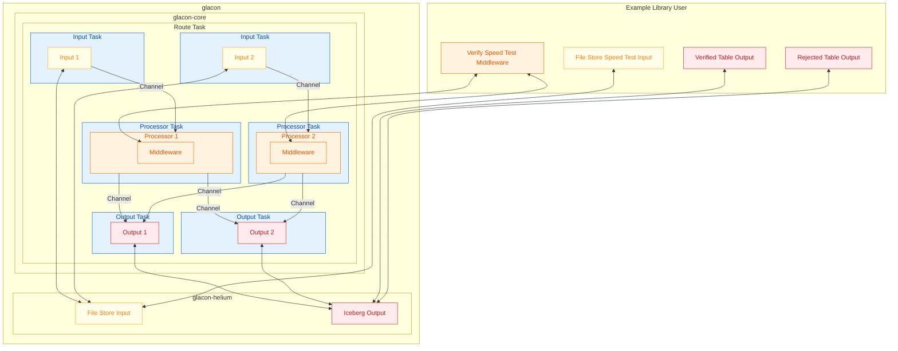
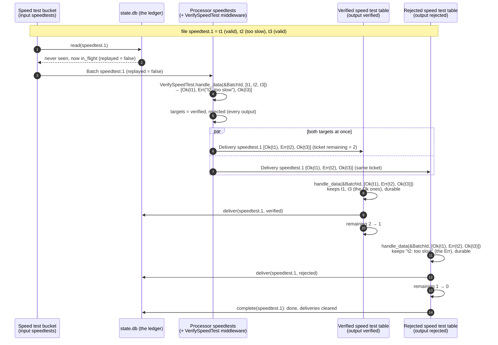

# glacon-core

Route records from inputs, through a middleware, to outputs.

A **route** reads records from **N inputs**, runs every batch through a
**middleware** that turns each record into a result (the new record, or an
error saying why there is none), and hands them to its **M outputs**, each
keeping what it wants of them. A route is an oracles
`task_manager::ManagedTask`: run it in your app's `TaskManager`, next to your
other routes and tasks.

This crate knows nothing of where records come from or go to: inputs,
middlewares and outputs are traits. [glacon-helium](../glacon-helium/README.md)
implements an S3 input and an Iceberg output.

## Architecture



Blue boxes are tasks, yellow are inputs, orange are processors and their
middleware, red are outputs.

- Every input runs in its own task and feeds its own processor through a
  channel.
- Every processor runs its own instance of the route's middleware, and sends
  every output the batch it transformed, through one channel per output.
- Every output runs in its own task, fed by every processor.
- Channels hold one batch besides the one being handled: a slow stage makes
  the stages before it wait.

[docs/runtime.md](../docs/runtime.md) lists every task and every step a
record goes through, from startup to shutdown.

## Usage

```rust
use glacon_core::{
    BatchId, BoxError, GlaconCoreMiddleware, GlaconRecordError, RecordResult, Route,
    RouteSettings, async_trait,
};

/// What the outputs get for a valid speed test.
#[derive(Clone)]
struct VerifiedSpeedTest(SpeedTest);

/// What the outputs get for an invalid one: one variant per kind of failure.
#[derive(Debug, thiserror::Error)]
enum VerifyError {
    #[error("{id}: upload too slow ({kbps} kbps)")]
    TooSlow { id: String, kbps: u64 },
    #[error("{id}: no location")]
    NoLocation { id: String },
}

impl GlaconRecordError for VerifyError {
    /// The `reason` label of `glacon_middleware_errors_total`.
    fn reason(&self) -> &'static str {
        match self {
            Self::TooSlow { .. } => "too_slow",
            Self::NoLocation { .. } => "no_location",
        }
    }
}

// Cloned for each input's processor.
#[derive(Clone)]
struct VerifySpeedTest;

#[async_trait]
impl GlaconCoreMiddleware<SpeedTest, VerifiedSpeedTest> for VerifySpeedTest {
    type Error = VerifyError;

    async fn handle_data(
        &mut self,
        _: &BatchId,
        tests: Vec<SpeedTest>,
    ) -> Result<Vec<RecordResult<VerifiedSpeedTest, VerifyError>>, BoxError> {
        // One result per test, in order.
        Ok(tests
            .into_iter()
            .map(|test| test.verify().map(|()| VerifiedSpeedTest(test))) // Result<_, VerifyError>
            .collect())
    }
}

// The ledger goes in /data/speedtests/state.db: a durable volume.
let route = Route::builder("speedtests", RouteSettings::new("/data/speedtests"))
    .input("us", us_input)              // any GlaconCoreInput<SpeedTest>
    .input("eu", eu_input)
    .middleware(VerifySpeedTest)        // SpeedTest -> Result<VerifiedSpeedTest, VerifyError>
    .output("verified", verified)       // any GlaconCoreOutput<VerifiedSpeedTest, VerifyError>,
    .output("rejected", rejected)       // keeping the Ok / the Err results
    .build()?;
```

- The builder follows the data: inputs, then the middleware, then outputs.
  The middleware sets the record and error types outputs get, so the
  compiler enforces the order. Without a middleware, outputs get the inputs'
  records unchanged, and no error (`Passthrough`, whose error is
  `Infallible`).
- A route has one middleware, given as a value and cloned for each input's
  processor. Share state between the clones through an `Arc`; create what
  can't be cloned (a connection) in its `init`.
- **Never drop: `Ok` or `Err`.** The middleware returns exactly one
  `RecordResult<Out, Self::Error>` (`Result<Out, Self::Error>`) per record it
  got, in order; another count fails the route
  (`Error::MiddlewareResultCount`). A record that can't go on as data
  (malformed, a duplicate, invalid) becomes an `Err` saying why, and every
  output gets it: one writes the errors to a rejects table, another counts
  them, another ignores them. The middleware's own failure (its store is
  down) is the outer `Err`, and stops the route.
- **The middleware's errors are its own type.** It declares
  `type Error`, any `GlaconRecordError` (typically an enum, one variant per
  kind of failure, carrying what was wrong with the record), and outputs get
  it as is, to match on. `GlaconRecordError::reason` maps each error to a
  short category from a fixed set (`"too_slow"`, `"duplicate"`): it labels
  `glacon_middleware_errors_total`, so it is a `&'static str`, never built
  from the record. Its `Display` is logged, never a label. An output that
  ignores errors implements `GlaconCoreOutput<R, E>` for any
  `E: GlaconRecordError`.
- Give every route its own `state_dir`. `RouteSettings` is serde-ready
  (`state_dir`, `processed_retention`).
- `Route` names its tasks `input <name>`, `processor <name>` and
  `output <name>` in the TaskManager's logs.

[glacon-helium's README](../glacon-helium/README.md#usage) completes this
example with S3 inputs and Iceberg tables.

## Hooks

Every stage follows the same lifecycle, all async: `init`, its main hook,
then `terminate`.

| Stage | `init` | main hook | `terminate` |
|---|---|---|---|
| input | `GlaconCoreInput::init(&mut self, ctx)`: connect, build a poller, …; resume from `ctx.ledger()`; returns its `State` and an optional background task (`InitializedInput`) | `next_batch(&mut state)`: the next `Batch`, or `None` when done | — (the input and its state are dropped) |
| middleware | `GlaconCoreMiddleware::init(&mut self, ctx)`: open a connection, … | `handle_data(&BatchId, Vec<In>) -> Vec<RecordResult<Out, Self::Error>>`: one result per record, `Ok` with the new record or `Err` with why not | release |
| output | `GlaconCoreOutput::init(&mut self, ctx)`: connect, create the table, …; returns its `State`, an optional background task, and whether the destination already holds data (`InitializedOutput::with_existing_data`) | `handle_data(&mut state, &BatchId, &[RecordResult<R, E>])`: gets every result of the batch, writes what it keeps of the records and errors, `Ok` once durable. Optional: `already_written(&mut state, &BatchId)`, asked on replays | `terminate(&mut state)`: flush |

Inputs and outputs are **one trait each**, implemented by their
configuration (what you give the builder). `init` builds the stage's `State`
(a plain struct: connections, channels, writers), and every later call gets
both the configuration (`&mut self`) and that state, so the state holds only
what exists once started: no `Option` fields, no "not initialized" case. A
stage with nothing to set up has `type State = ()` and returns
`Ok(InitializedInput::new(()))`.

The middleware's `init` and `terminate` default to doing nothing, as do the
output's `already_written` (no) and `terminate`. The `*Context` handed to
`init` names the route and the stage, and an input's gives it its view of
the ledger. Any `Send + Sync + 'static` type is a record (`GlaconRecord`).

`BatchId { input, key, timestamp }` names the batch records came from: the
input's name, and the `Batch`'s key and timestamp. The key must be the same
every time the input produces that batch (an S3 key, for example); the
timestamp may differ. The input and key identify the batch, in the ledger
and for any state keyed by batch.

### Background tasks

An input's or output's `init` adds a task, an oracles `ManagedTask`, when it
needs work running beside it: a poller feeding the input's state, a writer
committing the output's rows (`InitializedInput::new(state).with_task(poller)`).
Several tasks can be bundled into one `TaskManager`. The route supervises it:

- it is started before its stage and stopped after it: an input's task stops
  once the input stopped reading, an output's once the output terminated;
- its failure fails the route with the stage's error (`Error::Input` /
  `Error::Output`), and a panic with `Error::Panic` naming it (e.g.
  `input us: background`).

`init` must not spawn anything itself: if another stage then fails to
initialize, the route drops the returned tasks without ever starting them.

### Up and down

**Up:** before any task starts, the route opens its ledger, then initializes
its stages layer by layer: every output (then the fresh-state guard, see
below), then every input's middleware, then every input. If an `init` fails,
the layers already initialized are terminated and the route fails.

**Down:** the stages stop in reverse: inputs, then their background tasks,
then processors (handling what is queued, then the middleware's
`terminate`), then outputs (writing what is queued, then `terminate`), then
their background tasks. A stage always stops after everything feeding it:

- on shutdown: the route's TaskManager stops its tasks in that order;
- when every input is done: inputs return, their processors drain and stop,
  then the outputs drain and stop, and the route ends;
- on failure: the failing stage stops, the stages upstream of it stop first,
  then the rest of the route goes down in order, and the route fails with the
  stage's error (`Error::Input`, `Middleware`, `Output` or `Panic`).

## Delivery guarantees

A route run again on the same `state_dir`, after a failure or a restart,
carries on **without losing data**, and duplicates nothing outside one small
window.

### `state.db` (the ledger)

Every route keeps a SQLite database, `<state_dir>/state.db`
(`RouteSettings::state_dir`, which **must be durable**: a mounted volume). It
stores **no records**, only:

| Table | Holds |
|---|---|
| `batches` | One row per batch read: input, key, timestamp, `in_flight` or `done` |
| `deliveries` | Which outputs already took each `in_flight` batch (cleared once it is done) |

Records live in memory between stages. Recovery relies on the two places that
already hold them durably: the **source**, where a batch stays readable until
it is done, and the **outputs**, which have a batch durably once they
acknowledged it. So **inputs must be replayable**: after a restart, an input
produces again every batch not done, resuming from
`ctx.ledger().resume_point()` and skipping what `is_done(key)` says (the route
skips done batches itself too).

### One batch, from read to done

1. **Input task**: after `next_batch`, the route records the batch in the
   ledger. A batch never seen is now `in_flight`, one already `in_flight` is a
   **replay**, one `done` is skipped.
2. **Processor**: the middleware turns each record into a result, `Ok` or
   `Err`. Every output (a **target**) gets the whole batch, errors included,
   except, on a replay, the outputs that already took it. An empty batch, or
   one with no target left, is done right away. Otherwise the targets share one ticket that counts
   them.
3. **Output task**: on a replay, `already_written` is asked first. Then
   `handle_data`, which writes what this output keeps (maybe nothing):
   returning `Ok` means durable, and **is** the acknowledgement. The output
   is recorded in `deliveries`, then counts down the ticket. The last one
   marks the batch `done` (deliveries cleared, in one transaction).

A failing output never acknowledges: its batches stay `in_flight` and are
replayed on the next run, to that output only.



### On the next run

| The run stopped after… | `state.db` | Next run |
|---|---|---|
| reading a batch, before recording it | nothing | read again |
| recording it, before any write | `in_flight` | replayed to every output |
| an output's durable write, before it is recorded | `in_flight`, that output missing | **that output gets it again**, unless it implements `already_written` |
| one output recorded, not the others | `in_flight`, that output recorded | replayed to the others only |
| the last output recorded | `done` | skipped |
| a shutdown, while a batch waited to be sent | `in_flight` | replayed |

The duplicate window is that third row: one batch, for one output, when the
process died between the output's write and the ledger recording it. An
output that can tell it already has a batch (an idempotent key, a
transactional sink) closes it with `already_written`.

### Resume point and retention

Outputs finish at different speeds, so a later batch can be done before an
earlier one. An input resumes at its **oldest `in_flight` batch**, else its
newest done one. Done batches whose timestamp is older than
`RouteSettings::processed_retention` (default 3 days) are forgotten, keeping
each input's newest done batch and every `in_flight` one. The retention must
cover how far back an input may produce a batch again: a forgotten batch
seen again is delivered again.

### Replay-safe middleware and outputs

On a replay, the middleware sees the batch again, and must give the same
results. A stateless middleware does. One with state, like a deduplicating
one, keys it by batch, its input and key (not the whole `BatchId`, whose
timestamp may differ on a replay): remember which batch claimed each record,
return `Ok` for a record its own batch claimed, and `Err` for the others.
Save that state before `handle_data` returns, and keep it as long as a batch
may be produced again (`processed_retention`). Without it, a replayed batch
would call its own records duplicates: the outputs would get them as errors,
and never as data. See `deduplication_is_a_middleware` and
`deduplication_keeps_a_replayed_batch` in
`tests/integration/middleware_dedup.rs`. Likewise, an output decides what to
keep from the result alone.

### Lost state: the fresh-state guard

If `state.db` is lost (a volume not mounted, say), every input would start
over and duplicate what the outputs hold. So when a route starts with a
`state.db` it never ran on, and an output's `init` reported existing data
(`InitializedOutput::with_existing_data(true)`), the route refuses to start
(`Error::FreshStateRefused`), terminating the outputs it initialized. To start
over on purpose, build it with `.fresh_state(FreshState::Proceed)`.

## Metrics

Emitted through the `metrics` facade (the app installs an exporter). Every
series has a `route` label, plus `input` or `output` where it applies. Times
and durations are in milliseconds.

| Metric | Type | Labels | What |
|---|---|---|---|
| `glacon_processed_batches_total` | counter | `input` | Batches through the middleware and handed to the outputs |
| `glacon_batch_lag_ms` | gauge | `input` | Batch timestamp to processing, for the batch just processed. Frozen while nothing is processed |
| `glacon_last_batch_timestamp_ms` | gauge | `input` | Newest batch timestamp processed (Unix ms): `now - this` grows when a route stalls |
| `glacon_batch_processing_ms` | histogram | `input` | One batch through a processor: middleware, then hand-off |
| `glacon_middleware_ms` | histogram | `input` | The middleware's part |
| `glacon_output_handoff_ms` | histogram | `input` | Waiting for the outputs to take the batch: grows when an output is slower than the input |
| `glacon_middleware_errors_total` | counter | `input`, `reason` | Records the middleware turned into an `Err`, by `GlaconRecordError::reason` |
| `glacon_output_batches_total` | counter | `output` | Batches an output wrote |
| `glacon_output_records_total` | counter | `output`, `kind` | Results an output wrote: `ok` records, `err` middleware errors (it may keep fewer) |
| `glacon_output_write_ms` | histogram | `output` | One output's `handle_data` on one batch |
| `glacon_replayed_batches_total` | counter | `input` | Batches read again after a run that did not finish them |
| `glacon_skipped_deliveries_total` | counter | `output`, `reason` | Deliveries skipped: `ledger` (taken before a crash) or `already_written` (the output's hook) |
| `glacon_in_flight_batches` | gauge | `input` | Batches read but not done (every minute) |
| `glacon_state_pruned_total` | counter | `input` | Done batches forgotten by retention |

## Logs

Through `tracing`; every line has `route`, plus `input` or `output`. Errors
are logged with their whole cause chain (`ErrorChain`, also exported for
apps).

| Event | Level | Fields |
|---|---|---|
| `starting route`, `ledger opened` | info | `state_dir`, `processed_retention`, `inputs`, `outputs`, `fresh_state`; then `fresh` |
| `initializing output` / `output initialized` | info | `has_data`, `background_task`, `took_ms` |
| `initializing input` / `input initialized` | info | `resume_point` (from the ledger), `in_flight`, `took_ms` |
| `route started`, `route stopped` | info | |
| `route failed to start`, `route failed` | error | `error` |
| `processed batch` | info | `batch` (its key), `records`, `errors`, `error_reasons` (`duplicate=3 invalid=1`), `first_error`, `outputs`, `replayed`, `middleware_ms`, `handoff_ms` |
| `record error` | debug | `batch`, `reason`, `message`: every middleware error |
| `wrote batch` | debug | `batch`, `ok`, `err`, `took_ms` |
| `replaying batch`, `already written` | info | `batch` |
| `skipping done batch`, `pruned the ledger` | debug | |
| `processor stopped, stopping input`, `output stopped, stopping processor` | warn | follows a failure, logged as `route failed` |
| `input finished` | info | |

The TaskManager names a route's tasks `input <name>`, `processor <name>`,
`output <name>` and `input|output <name>: background`.


## Tests

The tests need no services: in-memory inputs, middlewares and outputs, each
route with a real `state.db` in a temp dir.

```bash
cargo nextest run -p glacon-core
```

`tests/integration` has one file per part of a route (`input.rs`,
`middleware.rs`, `output.rs`), one for the route as a whole (`route.rs`), and
one for deduplication (`middleware_dedup.rs`). Each file has its tests first,
then the helpers they use.
